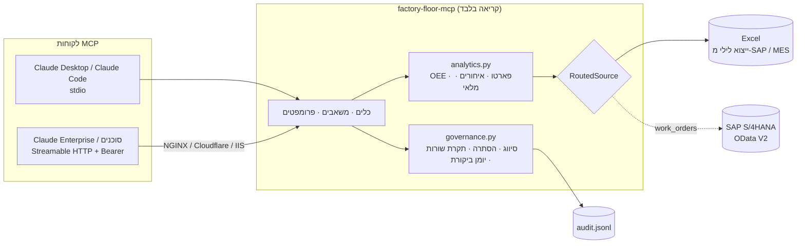

<div dir="rtl">

# factory-floor-mcp · שרת MCP לנתוני רצפת ייצור

[](https://github.com/E37dey/factory-floor-mcp/actions/workflows/ci.yml)   

**שרת MCP לקריאה בלבד שנותן ל-Claude (או לכל לקוח MCP) גישה בטוחה לנתוני ייצור: מכונות, יומן ייצור, השבתות, פסולים, הזמנות עבודה ומלאי.** הנתונים מגיעים מקובץ Excel (למשל ייצוא לילי מ-SAP או מ-MES), או ישירות מ-SAP S/4HANA דרך OData.

מנהל מפעל שואל בעברית "למה ה-OEE ירד השבוע?" או "אילו הזמנות יאחרו בגלל חוסר בחומר?". Claude קורא לכלים של השרת, מקבל מספרים מדויקים שחושבו בקוד, ועונה עם הסבר. השרת לא משנה אף נתון, מסתיר עמודות רגישות לפי מדיניות, ורושם כל קריאה ביומן ביקורת.

> נתוני הדוגמה בריפו בדויים: מפעל קטן לעיבוד שבבי מדויק עם 8 מכונות CNC בשני קווים, יולי עד ספטמבר 2026.

## מה אפשר לשאול

| שאלה של משתמש | הכלים ש-Claude מפעיל |
|---|---|
| "תן לי תמונת מצב של החודש מול החודש הקודם" | `production_kpis` |
| "איזו מכונה הכי בעייתית, ולמה?" | `machine_oee`, `downtime_pareto` עם `machine_id`, `downtime_events` |
| "מה גורם לרוב ההשבתות בקו B?" | `downtime_pareto` עם `line` |
| "אילו הזמנות באיחור, ואילו בסיכון לשבוע הבא?" | `late_work_orders` |
| "מה ייגמר לנו לפני שהספק יספיק לספק?" | `inventory_alerts` |
| "איפה הכי הרבה פסולים?" | `scrap_summary` |
| "מה קרה עם WO-26043?" | `search_records` |
| "הכן דוח משמרת למנהל" | הפרומפט המובנה `shift_report` |

<details>
<summary><b>דוגמה: מה Claude מקבל מהכלים</b> (פלט אמיתי של <code>examples/morning_brief.py</code>, בלי מודל שפה)</summary>

## תמונת מצב: 2026-08-26 עד 2026-09-24

- OEE: **74.3%** (-1.5 נקודות מול התקופה הקודמת)
- זמינות 88.5% · ביצועים 85.8% · איכות 97.8%
- השבתות לא מתוכננות: 234.1 שעות
- אספקה בזמן: 69.2% (27 מתוך 39 הזמנות שהושלמו)

### שלוש המכונות עם ה-OEE הנמוך

- CNC-08: 66.5% (זמינות 89.3%, ביצועים 75.6%, איכות 98.5%)
- CNC-04: 71.1% (זמינות 83.6%, ביצועים 86.8%, איכות 98.1%)
- CNC-05: 71.2% (זמינות 84.9%, ביצועים 87.3%, איכות 96.0%)

### סיבות ההשבתה המובילות

- תקלת ציר: 3,950 דקות, 39 אירועים (28.1%)
- המתנה לחומר גלם: 3,259 דקות, 72 אירועים (23.2%)
- חוסר מפעיל: 2,110 דקות, 35 אירועים (15.0%)

### הזמנות באיחור: 17

- WO-26075 · מקדח קרביד 12 מ״מ · 1000 יח׳ · 61 ימי איחור · ממתין לחומר
- WO-26043 · תותב הברגה M12 · 250 יח׳ · 51 ימי איחור · ממתין לחומר
- WO-26092 · מקדח קרביד 12 מ״מ · 100 יח׳ · 50 ימי איחור · ממתין לחומר

### חומרים מתחת לנקודת ההזמנה: 3

- אינסרט חריטה CNMG: 4.8 ימי מלאי, זמן אספקה 5 ימים · **ייגמר לפני שהספק יספיק לספק**
- מוט קרביד 12 מ״מ: 6.1 ימי מלאי, זמן אספקה 21 ימים · **ייגמר לפני שהספק יספיק לספק**
- נוזל קירור (ליטר): 7.7 ימי מלאי, זמן אספקה 7 ימים

זה בדיוק סוג הקשר ש-Claude צריך למצוא: הזמנות של מקדח 12 מ״מ מחכות לחומר, ומוט הקרביד של 12 מ״מ מתחת לנקודת ההזמנה עם זמן אספקה של שלושה שבועות.
</details>

## כלים, משאבים ופרומפטים

| כלי | מה הוא מחזיר |
|---|---|
| `list_datasets` | הטבלאות, מספר שורות, טווח תאריכים ואילו עמודות מוסתרות |
| `production_kpis` | OEE ושלושת רכיביו, חלקים תקינים ופסולים, שעות השבתה, אספקה בזמן, הזמנות באיחור, חוסרי מלאי. בהשוואה לתקופה הקודמת באותו אורך |
| `machine_oee` | OEE לפי מכונה, קו, יום או משמרת, מהגרוע לטוב |
| `downtime_pareto` | השבתות לפי סיבה, עם אחוז מצטבר ו"המעטים החשובים" (80% מהדקות) |
| `downtime_events` | אירועי השבתה בודדים להעמקה. שמות מפעילים מוחלפים בכינוי קבוע |
| `scrap_summary` | כמות ושיעור פסולים לפי סיבה, מכונה או מוצר |
| `get_work_orders` | הזמנות לפי סטטוס, קו, מוצר וטווח תאריכי יעד |
| `late_work_orders` | הזמנות באיחור והזמנות בסיכון לימים הקרובים |
| `inventory_alerts` | חומרים מתחת לנקודת ההזמנה, ימי מלאי, האם ייגמרו לפני אספקה, והצעת כמות להזמנה |
| `search_records` | חיפוש חופשי ברשומות (לא בעמודות מוסתרות) |

**משאבים:** `factory://schema` (מילון נתונים עם סיווג לכל עמודה), `factory://policy` (מה השרת רשאי להחזיר), `factory://audit/recent` (50 הקריאות האחרונות).
**פרומפטים:** `shift_report` (דוח ייצור יומי למנהל, בעברית), `downtime_rca` (ניתוח שורש להשבתות של מכונה).

כל הכלים מסומנים `readOnlyHint`. הקלט עובר ולידציה (תאריכים, מזהים, טווחים), וקלט שגוי מחזיר שגיאה ברורה ולא ניחוש.

## ארכיטקטורה



- **חישובים בקוד, לא במודל.** OEE, פארטו, ימי מלאי ואיחורים מחושבים ב-`analytics.py` עם בדיקות יחידה. המודל מסביר ומקשר, ולא עושה חשבון.
- **מקור נתונים לכל טבלה.** `RoutedSource` מאפשר, למשל, הזמנות עבודה מ-SAP ושאר הטבלאות מ-Excel. קובץ Excel נטען מחדש אוטומטית כשהוא משתנה בדיסק.
- **הפרדה בין פרוטוקול ללוגיקה.** `create_server()` מקבל מקור, מדיניות ויומן, ולכן כל שכבה נבדקת בנפרד.

## ממשל נתונים ואבטחה

| עיקרון | איך זה ממומש |
|---|---|
| קריאה בלבד | אין אף כלי שכותב. הקוד לא מכיל קריאות כתיבה ל-SAP או לקובץ |
| סיווג מידע | לכל עמודה רמה: ציבורי, פנימי או חסוי (`governance.py`). ברירת המחדל מחזירה עד "פנימי" |
| הסתרה | שמות לקוחות, מחירים ועלויות מוחלפים ב-`[מוסתר]`. שמות מפעילים מוחלפים בכינוי קבוע (`עובד-1A2B3C`), כך שאפשר לנתח לפי מפעיל בלי לחשוף זהות. עמודות מוסתרות לא ניתנות לחיפוש |
| מזעור | תקרת שורות לכל תשובה (`FACTORY_MCP_MAX_ROWS`), וכל רשימה מציינת אם נחתכה |
| יומן ביקורת | כל קריאה, כולל כאלה שנכשלו, נרשמת ב-JSONL: זמן, כלי, פרמטרים, מספר שורות, משך ושגיאה |
| אימות ב-HTTP | Bearer token חובה (לפחות 24 תווים, השוואה בזמן קבוע), ומטא-דאטה של OAuth Protected Resource לפי מפרט MCP. בלי טוקן השרת מסרב לעלות ב-HTTP |
| הרצה בקונטיינר | משתמש לא-root, מערכת קבצים לקריאה בלבד ב-compose, והשרת חשוף רק דרך NGINX עם TLS |

הגדרות: `FACTORY_MCP_MAX_LEVEL` (public / internal / confidential), `FACTORY_MCP_MAX_ROWS`, `FACTORY_MCP_AUDIT_LOG`, `FACTORY_MCP_SALT` (למלח הכינויים), `FACTORY_MCP_TOKEN`.

## התקנה וחיבור

```bash
pip install git+https://github.com/E37dey/factory-floor-mcp
```

**Claude Code:**
```bash
claude mcp add factory-floor -- factory-floor-mcp --data /exports/plant.xlsx
# או לשרת מרוחק:
claude mcp add --transport http factory-floor https://mcp.plant.example/mcp --header "Authorization: Bearer $FACTORY_MCP_TOKEN"
```

**Claude Desktop:** מוסיפים ל-`claude_desktop_config.json` את הבלוק שב-[`examples/claude_desktop_config.json`](examples/claude_desktop_config.json).

**שרת בארגון (Docker + NGINX):**
```bash
docker build -t factory-floor-mcp .
cd deploy && FACTORY_MCP_TOKEN=$(openssl rand -hex 32) docker compose up -d
```
[`deploy/nginx.conf`](deploy/nginx.conf) חושף רק את `/mcp` ואת המטא-דאטה של OAuth, עם buffering כבוי (התשובות יכולות לזרום). אותו עיקרון חל מאחורי Cloudflare Tunnel או IIS עם ARR.

## חיבור לנתונים שלכם

**Excel:** חוברת עם גיליון לכל טבלה ושורת כותרת. שמות העמודות כמו בקובץ הדוגמה (`scripts/make_sample_data.py` מתעד אותם). מצביעים עליה עם `--data` או `FACTORY_MCP_DATA`.

**SAP S/4HANA:** מגדירים `SAP_ODATA_BASE` (שירות `API_PRODUCTION_ORDER_2_SRV`), משתמש טכני לקריאה בלבד (`SAP_USER` / `SAP_PASSWORD`) או `SAP_TOKEN`, ואופציונלית `SAP_PLANT`. הזמנות העבודה ייקראו מ-SAP, עם דפדוף וסינון לפי מפעל, והשאר מ-Excel. המיפוי בין שדות SAP לעמודות נמצא במילון `FIELD_MAP` ב-`sap.py`.

> המתאם ל-SAP נבדק מול תשובות OData מדומות בלבד, לא מול מערכת SAP חיה. שמות השדות לקוחים מהתיעוד הציבורי של SAP, וכדאי לאמת אותם מול המערכת שלכם.

## בדיקות

25 בדיקות pytest רצות ב-GitHub Actions על Python 3.10 ו-3.12, ואחריהן בנייה של קונטיינר ובדיקה שהוא מסרב לבקשות בלי טוקן:

- **חישובים:** OEE לפי ההגדרה המקובלת, פארטו עם אחוז מצטבר, איחורים והזמנות בסיכון, התראות מלאי, השוואה לתקופה קודמת, ועקביות של נתוני הדוגמה.
- **ממשל:** הסתרה לפי רמה, כינויים קבועים, הגדרות מסביבה, יומן ביקורת בקובץ.
- **פרוטוקול MCP:** לקוח MCP אמיתי מול השרת (בזיכרון ובתהליך stdio נפרד): רשימת כלים וסכמות, תקרת שורות, דחיית קלט שגוי, הסתרה בחיפוש, משאבים ופרומפטים, רישום של קריאות שנכשלו.
- **SAP:** פענוח תאריכי OData, מיפוי סטטוסים, דפדוף, סינון לפי מפעל וכותרת אימות, והשרת כשהזמנות העבודה מגיעות מ-SAP.
- **HTTP:** 401 בלי טוקן או עם טוקן שגוי, 200 עם טוקן נכון, ומטא-דאטה של OAuth.

```bash
pip install -e ".[dev]"
pytest -q
python examples/morning_brief.py
```

## מגבלות ידועות

- טוקן משותף אחד מתאים לפריסה פנימית. לגישה לפי משתמש מחליפים את `StaticTokenVerifier` באימות מול ספק הזהויות של הארגון (למשל Entra ID) וממפים קבוצות להרשאות.
- המתאם ל-SAP מכסה הזמנות ייצור בלבד, ולא נבדק מול מערכת חיה.
- בנוי על MCP Python SDK מסדרה 1.x (נעול ל-`<2`). המעבר לסדרה 2.x עוד לא נעשה.
- נתוני הדוגמה בדויים.

</div>

---

## English summary

**factory-floor-mcp** is a read-only [Model Context Protocol](https://modelcontextprotocol.io) server that gives Claude safe access to manufacturing data: machines, production log, downtime, scrap, work orders and inventory, from an Excel export or SAP S/4HANA (OData V2).

- 10 tools (OEE by machine/line/day/shift, downtime Pareto with vital few, late and at-risk orders, inventory alerts with stock-out-before-delivery, scrap, plant KPIs vs previous period, search), 3 resources (schema with classification, policy, recent audit), 2 prompts (daily shift report, downtime RCA).
- All numbers are computed in code and unit-tested; the model explains them.
- Governance: read-only, column-level classification, masking and stable pseudonyms for people, row caps, JSONL audit log of every call including failures.
- Transports: stdio for Claude Desktop / Claude Code; Streamable HTTP with bearer-token auth and OAuth protected-resource metadata; Docker image (non-root) with an NGINX reverse-proxy example.
- 25 pytest tests including protocol-level tests with a real MCP client and a stdio subprocess; CI builds the container and checks it rejects unauthenticated calls.
- Built on the MCP Python SDK 1.x (pinned `<2`). The SAP adapter is tested against mocked OData responses only.

Sample data is fictional. MIT License.
